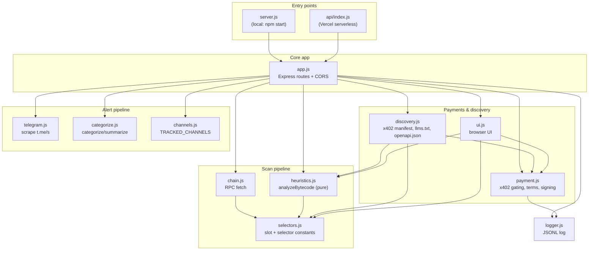
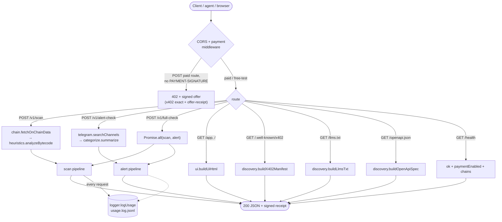

# contract-risk-api

Pre-trade safety checks for smart contracts and tokens. Three paid x402 routes
all settling in USDC on Base mainnet — risk scoring, Telegram alert-channel
monitoring, and a combined check.

**Live**: https://smartcontractrisk.0xhodhod.xyz

Monetization: standard x402 ("exact" scheme) via **PayAI's facilitator**
(facilitator.payai.network, free tier, no signup). Settlement is
peer-to-peer on-chain straight to a wallet you control — the facilitator
only verifies signatures and broadcasts the transaction, it never
custodies funds. Chosen after ruling out Coinbase's facilitator (per
instruction) and Nevermined (forces a mandatory Stripe Connect payout,
which wasn't usable — see git history for that abandoned integration).

Every 402 carries a **signed offer** and every 200 carries a **signed
receipt** (EIP-712), plus the settlement transaction hash at the top
level of the same header. See [Signed offers & receipts](#signed-offers--receipts).

## Diagrams

Module dependency graph


Request flow


## **Endpoints**


| **Method** | **Path**            | **Price** | **Purpose**                                           |
| ---------- | ------------------- | --------- | ----------------------------------------------------- |
| POST       | `/v1/scan`          | $0.02     | Contract risk score (bytecode + EIP-1967 proxy)       |
| POST       | `/v1/alert-check`   | $0.03     | Telegram alert-channel monitoring                     |
| POST       | `/v1/full-check`    | $0.04     | Combined check (scan + alerts, cheaper than separate) |
| GET        | `/app`              | free      | Browser UI                                            |
| GET        | `/health`           | free      | Liveness check                                        |
| GET        | `/.well-known/x402` | free      | Machine-readable x402 manifest                        |
| GET        | `/llms.txt`         | free      | Plain-text summary for LLM crawlers                   |
| GET        | `/openapi.json`     | free      | Canonical OpenAPI 3.1 spec (required by x402scan)     |


The original unversioned `/scan` route was removed. It existed only because  
PayAI's catalog keys rows by URL and never re-reads metadata for an existing  
row — `/v1/scan` earned a fresh row with `serviceName`/`tags`. That purpose  
is served; `/scan` was removed to reduce the x402scan probe surface and the  
drift risk of two paths that must stay in sync.

## **Browser UI**

**The UI lives at** `/app`**.** `GET /` returns Vercel's  
`FUNCTION_INVOCATION_FAILED` no matter what the function does, so `vercel.json`  
redirects `/` → `/app` rather than trying to serve the root.

That wasn't a guess: `/app` serves the identical page from the identical  
handler and works, while `/` fails. The crash is also unreachable from  
Express — the route is wrapped in try/catch and the global error handler is  
confirmed live in production (a malformed-JSON POST returns its JSON, not  
Vercel's error page) — and `/` works locally under Node 18 and 22, via  
`src/server.js` and via `api/index.js` invoked the way Vercel invokes it. So  
it is the platform's root-path routing, not this code.

`/app` serves a self-contained page that lets a human pay for a scan with a  
browser wallet — connect, sign, read the result — with no tooling. It  
implements the x402 "exact" EVM scheme by hand against `window.ethereum`  
(the client SDKs assume a bundler, which this deploy target doesn't have),  
signing the EIP-3009 authorization via `eth_signTypedData_v4`. Payment is  
gasless for the visitor; the facilitator broadcasts and covers gas.

The payload shape wasn't guessed: it was validated against the facilitator's  
`POST /verify`, which checks the signature and balance *without settling*, so  
the browser code was proven correct at zero cost before being written.  
`/verify` is the right tool for testing payment changes — use it instead of  
burning real settlements.

**Note on wallets:** the UI assumes EOA-style typed-data signing. Smart-contract  
wallets (Coinbase Smart Wallet, Safe) and some mobile wallets (Trust Wallet,  
which uses its own hosted RPCs) may not support `eth_signTypedData_v4` in the  
same way. Agents — the primary audience — sign with a private key in code and  
never touch the UI.

The page is served from a JS module rather than a static file because files  
read from disk at request time aren't reliably included in Vercel's function  
bundle, while an imported module always is.

## **What's built**

- `POST /v1/scan { address, chain }` → risk score, running against **live**  
Base/Ethereum mainnet data over free public RPC endpoints (no signup).
- `POST /v1/alert-check { address, chain }` → Telegram alert-channel monitor:  
scrapes `t.me/s/<channel>` for 10 tracked crypto channels, categorizes  
mentions into `securityAlert`, `whaleMovement`, `listing`, `other`.
- `POST /v1/full-check { address, chain }` → returns `{ risk, alerts }` in one  
call, running both pipelines in parallel (`Promise.all`).
- Heuristics are pure functions (`src/heuristics.js`), unit-tested without  
network access (`test/heuristics.test.js`, 7/7 passing).
- Every request is logged to `usage.log.jsonl` (JSON Lines) — best-effort  
only (not durable on Vercel's serverless runtime). The facilitator/chain  
itself is the authoritative evidence source for real payments received.
- Payment gating (`src/payment.js`) uses the generic `@x402/express` +  
`@x402/core` + `@x402/evm` SDK with `@payai/facilitator`, gated by  
`ENABLE_PAYMENTS` (default `false` — free/test mode, logged as  
`paymentMode: "free-test"`).
- Signed offers/receipts via `@x402/extensions/offer-receipt` (EIP-712). See  
Signed offers & receipts.
- Three discovery surfaces (`src/discovery.js`, all generated from  
`payment.js`'s term builders so they can't drift): `/.well-known/x402`,  
`/llms.txt`, `/openapi.json`.
- Deployed on Vercel: `src/app.js` exports the Express app, `api/index.js`  
wraps it as a serverless function, `src/server.js` is the local-dev  
entry point (`npm start`).
- Project is ESM (`"type": "module"`).

## **How to verify it's actually working**

bash

```
curl -s https://smartcontractrisk.0xhodhod.xyz/health

# Use a demo address that actually trips the heuristic (see "Demo addresses"
# below) — the USDC example returns an empty result and looks broken.
curl -s -i -X POST https://smartcontractrisk.0xhodhod.xyz/v1/scan \
  -H "Content-Type: application/json" \
  -d '{"address":"0x2260FAC5E5542a773Aa44fBCfeDf7C193bc2C599","chain":"ethereum"}'
# expect 402 with a payment-required header when ENABLE_PAYMENTS=true; decode:
#   echo "<header value>" | base64 -d | jq
# check: network is "eip155:8453" (Base MAINNET, real money) and payTo
# matches your wallet. The header also carries a signed offer under
# extensions["offer-receipt"].info.offers.
```

On Windows PowerShell, use `curl.exe` (not the `curl` alias) and escape  
inline JSON:

powershell

```
curl.exe -s -i -X POST https://smartcontractrisk.0xhodhod.xyz/v1/scan `
  -H "Content-Type: application/json" `
  -d '{\"address\":\"0x2260FAC5E5542a773Aa44fBCfeDf7C193bc2C599\",\"chain\":\"ethereum\"}'
```

## **Understanding the response**

A scan reads the contract's live runtime bytecode and its EIP-1967 proxy  
storage slot, adds a weight for each risk signal it finds, and reports the  
total. Nothing is inferred from the token's name, its liquidity, or any  
off-chain reputation source — only what the deployed code exposes.

### **Fields**


| **Field**          | **Meaning**                                                                                                                 |
| ------------------ | --------------------------------------------------------------------------------------------------------------------------- |
| `riskLevel`        | The band `riskScore` falls into: `low`, `medium`, `high`, or `unknown`.                                                     |
| `riskScore`        | Sum of the weights of every signal found. Higher means more owner power.                                                    |
| `isContract`       | Whether the address has bytecode. `false` means a wallet (EOA) or an address nothing is deployed to yet.                    |
| `isProxy`          | Whether the EIP-1967 implementation slot is set — an admin can swap the contract's logic for different code.                |
| `flags`            | One entry per signal found, each `{ label, weight }`. `label` is human-readable; `weight` is its contribution to the score. |
| `address`, `chain` | Echoed back, so a stored result is self-describing.                                                                         |
| `note`             | Present only when there is no code to analyse.                                                                              |


### **Levels**


| **Level** | **Score** | **Reading**                                     |
| --------- | --------- | ----------------------------------------------- |
| `low`     | 0–9       | No centralised-control signals found.           |
| `medium`  | 10–29     | Privileged functions or upgradeability present. |
| `high`    | 30+       | Several powerful owner capabilities at once.    |
| `unknown` | —         | Not a contract, so there is nothing to score.   |


### **Weights**


| **Signal**                            | **Weight** |
| ------------------------------------- | ---------- |
| Upgradeable proxy (EIP-1967 slot set) | +10        |
| `owner()`                             | +5         |
| `transferOwnership(address)`          | +5         |
| `mint(address,uint256)`               | +15        |
| `pause()`                             | +10        |
| `blacklist(address)`                  | +20        |
| `setBlacklist(address,bool)`          | +20        |
| `excludeFromFee(address)`             | +5         |
| `setTaxFee(uint256)`                  | +15        |


Maximum possible score is 105. `renounceOwnership()` and `unpause()` are  
recognised but weighted 0 — they are context for other findings rather than  
risks themselves, so they never appear as flags.

These numbers are not duplicated by hand: the `/app` page builds its tables  
from `RISK_THRESHOLDS`, `PROXY_WEIGHT` and `FLAGGED_SELECTORS` directly, and a  
test asserts the rendered bands and weights match the scorer's constants.

### **How to read a result**

**A high score is not proof of a scam, and a low score is not a safety**  
**guarantee.** Many legitimate tokens are pausable, mintable, and upgradeable by  
design — USDC is all three. What the score tells you is *how much power the*  
*contract's owner holds over your funds*, so you can decide whether you trust  
whoever holds it. A `high` result on an unknown deployer is a very different  
thing from the same result on a well-known issuer.

Read it as a prompt to look closer, not a verdict — and note the two known  
blind spots below (non-EIP-1967 proxies, and bytecode-level under-detection).

### **How to read an alert-check result**

`alertMentions` counts appearances in the **current rolling window** — the  
last 30 messages of each tracked channel, cached for up to 15 minutes  
(`PeckShieldAlert`, which is low-volume, gets a 15-minute cache; the rest get  
5 minutes). `securityAlert: 0` means "no security-channel mentions in the  
current window", **not** "never flagged". Absence of alerts is not a safety  
guarantee.

Categories: `securityAlert`, `whaleMovement`, `listing`, `other`.  
`lastCheckedAt` reports the scan timestamp, so a caller can reason about  
freshness.

## **Demo addresses (verified against live mainnet)**

The published example (USDC) scores 0 with no flags, which makes the API look  
inert. These were run through the real heuristic — `node scripts/probe-candidates.js` re-checks them and prints the full table.


| **Address**                                                     | **Chain** | **Result**                                                 |
| --------------------------------------------------------------- | --------- | ---------------------------------------------------------- |
| `0x2260FAC5E5542a773Aa44fBCfeDf7C193bc2C599` (WBTC)             | ethereum  | **high**, score 35 — owner, transferOwnership, mint, pause |
| `0x111111111117dC0aa78b770fA6A738034120C302` (1INCH)            | ethereum  | medium, score 25 — owner, transferOwnership, mint          |
| `0xdAC17F958D2ee523a2206206994597C13D831ec7` (USDT)             | ethereum  | medium, score 20 — owner, transferOwnership, pause         |
| `0xd9aAEc86B65D86f6A7B5B1b0c42FFA531710b6CA` (USDbC)            | base      | medium, score 10 — **proxy detected**                      |
| `0x2Ae3F1Ec7F1F5012CFEab0185bfc7aa3cf0DEc22` (cbETH)            | base      | medium, score 10 — **proxy detected**                      |
| `0x4200000000000000000000000000000000000010` (L2StandardBridge) | base      | medium, score 10 — **proxy detected**                      |
| `0x87870Bca3F3fD6335C3F4ce8392D69350B4fA4E2` (Aave v3 Pool)     | ethereum  | medium, score 10 — **proxy detected**                      |
| `0x0000000000000000000000000000000000000000`                    | either    | `riskLevel: "unknown"` — EOA/no code path                  |


WBTC is the best single demo (proxy aside): four flags and the only `high` in  
the set. USDbC is the best proxy demo on Base, and is what the UI prefills.

### **Copy-pasteable**

Swap the host for `http://localhost:3000` to run these free against a local  
server (`ENABLE_PAYMENTS` unset), or pay them for real with  
`SCAN_ADDRESS=... SCAN_CHAIN=... npm run pay:scan`.

bash

```
# Highest-signal demo: WBTC, four privileged-function flags
curl -s -X POST https://smartcontractrisk.0xhodhod.xyz/v1/scan \
  -H "Content-Type: application/json" \
  -d '{"address":"0x2260FAC5E5542a773Aa44fBCfeDf7C193bc2C599","chain":"ethereum"}'

# Proxy detection on Base
curl -s -X POST https://smartcontractrisk.0xhodhod.xyz/v1/scan \
  -H "Content-Type: application/json" \
  -d '{"address":"0xd9aAEc86B65D86f6A7B5B1b0c42FFA531710b6CA","chain":"base"}'
```

Real responses (captured from the live heuristic, not illustrative):

json

```
{
  "address": "0x2260FAC5E5542a773Aa44fBCfeDf7C193bc2C599",
  "chain": "ethereum",
  "isContract": true,
  "isProxy": false,
  "flags": [
    { "label": "has an owner() function (centralized control)", "weight": 5 },
    { "label": "owner can transfer ownership", "weight": 5 },
    { "label": "owner/admin can mint new tokens", "weight": 15 },
    { "label": "owner/admin can pause transfers", "weight": 10 }
  ],
  "riskScore": 35,
  "riskLevel": "high"
}
```

json

```
{
  "address": "0xd9aAEc86B65D86f6A7B5B1b0c42FFA531710b6CA",
  "chain": "base",
  "isContract": true,
  "isProxy": true,
  "flags": [
    { "label": "upgradeable proxy (EIP-1967) — logic can be swapped by admin", "weight": 10 }
  ],
  "riskScore": 10,
  "riskLevel": "medium"
}
```

## **Signed offers & receipts**

Every 402 carries an EIP-712 signed **offer** committing to the payment terms;  
every 200 carries a signed **receipt** confirming delivery. Implemented with  
the official `@x402/extensions/offer-receipt` extension — no custom crypto,  
no shared secret.

**Why:** the trust question for x402 is "how does an agent know this endpoint  
does what it says?" Self-written catalog descriptions answer nothing. An audit  
of 600 records across PayAI's discovery index (Oct 2026) found **zero**  
declaring the offer-receipt extension. This service is, as far as that sample  
shows, the only one on the index that signs its deliveries.

**Key separation:** `SIGNING_PRIVATE_KEY` is a dedicated key, distinct from  
`EVM_ADDRESS`. The spec requires this — a compromised signing key should not  
be a compromised payout wallet. The signing key never holds funds.

**Verification (client-side, no trust in this repo required):**

1. `GET /.well-known/x402` → read `signing.address`.
2. Take the `PAYMENT-RESPONSE` header from any 200, base64-decode it.
3. Read `extensions["offer-receipt"].info.receipt` — an EIP-712 signature over  
`{ version, network, resourceUrl, payer, issuedAt }`.
4. Recover the signer and compare to `signing.address`.
5. Read the **top-level** `transaction` field in the same header — that's the  
Base settlement hash. Confirm on basescan.

`scripts/dump-receipt.js` does steps 2–4 for inspection.

**What a receipt proves:** who produced this response, for which payer, at what  
time. **What the top-level** `transaction` **proves:** settlement occurred on-chain  
at that hash. **What neither proves:** that the underlying risk score or alert  
counts are correct. A signature answers "who said this and when", not "is it  
true" — the same caveat the risk score itself carries. Receipts make disputes  
*resolvable*; they do not make claims *true*.

**Note on the settlement hash location:** the receipt's own schema marks  
`transaction` as **optional**, and this extension leaves it empty. The  
settlement hash lives at the **top level** of `PAYMENT-RESPONSE` (standard  
x402 envelope), not inside the signed receipt. This separation is deliberate  
and stronger — the receipt attests to *who/when*, the chain attests to  
*settled*. Neither trusts the other.

**Known limitation:** signing identity is published at `/.well-known/x402`  
under `signing`. There is no `/.well-known/did.json` — `did:pkh` is  
self-resolving (the address *is* the identifier), so no document fetch is  
needed. If you later want domain-bound identity, the spec describes `did:web`

- `did.json` and on-chain attestation via OMA Trust.

## **Discovery surfaces**

Three machine-readable surfaces, all generated from `payment.js`'s term  
builders so they can't drift:

- `GET /.well-known/x402` — x402 manifest (also parsed by PayAI and x402scan).  
Includes the `signing` block when offers/receipts are active.
- `GET /llms.txt` — plain-text summary for LLM crawlers. Contains the full  
verification recipe for offers/receipts.
- `GET /openapi.json` — **canonical OpenAPI 3.1 spec**, required for x402scan  
registration. Lists only the three paid `/v1/*` routes; free routes are  
deliberately excluded because x402scan rejects specs that advertise  
non-paid paths.

All three reflect real config either way: while `ENABLE_PAYMENTS` is off they  
report `"mode": "free-test"` and `payTo: null`; once it's on they report the  
actual price/network/wallet being charged.

## **Distribution**

Nothing earns until agents/bots actually find and call this.

**PayAI** runs the facilitator's discovery catalog at  
`GET https://facilitator.payai.network/discovery/resources` and is tied  
directly to the facilitator we already use. Each new URL gets its own row the  
first time a payment settles against it. Both `/v1/alert-check` and  
`/v1/full-check` are live in the catalog.

**x402scan** (`x402scan.com`) crawls each origin's `/openapi.json`, probes  
every advertised endpoint for a real x402 402 challenge, and indexes the ones  
that pass. Registration: submit the origin at  
`x402scan.com/resources/register`.

**Coinbase's CDP-run x402 Bazaar** only indexes CDP-facilitator traffic, so it  
won't auto-list us. No action available.

## **Running locally**

bash

```
npm install
cp .env.example .env       # set EVM_ADDRESS, SIGNING_PRIVATE_KEY if testing payments
npm start                  # node src/server.js
npm test                   # runs test/heuristics.test.js (no network needed)
```

**Node 20+ is required to run** `npm run pay:scan`**.** Signing the x402  
authorization needs the WebCrypto global, which Node 18 exposes to ESM only  
behind a flag (without it the SDK fails with a bare "Crypto API not  
available" from deep in the stack). The script checks this up front and tells  
you what to do. On a Node 18 machine, either upgrade or run:

bash

```
node --experimental-global-webcrypto scripts/pay-and-scan.js
```

**Env vars** (see `.env.example` for the full list):


| **Var**               | **Required when**      | **Notes**                                                                      |
| --------------------- | ---------------------- | ------------------------------------------------------------------------------ |
| `EVM_ADDRESS`         | `ENABLE_PAYMENTS=true` | Payout wallet. Every payment lands here.                                       |
| `SIGNING_PRIVATE_KEY` | `ENABLE_PAYMENTS=true` | **Dedicated** receipt-signing key, distinct from `EVM_ADDRESS`. Never fund it. |
| `PRICE_PER_SCAN`      | optional               | Default `$0.02`                                                                |
| `PRICE_PER_ALERT`     | optional               | Default `$0.03`                                                                |
| `PRICE_PER_FULLCHECK` | optional               | Default `$0.04`                                                                |
| `X402_NETWORK`        | optional               | Default `eip155:8453` (Base mainnet)                                           |


Generate a signing key with:

bash

```
node -e "console.log(require('ethers').Wallet.createRandom().privateKey)"
```

Then publish its address via `/.well-known/x402 → signing.address`. That  
address becomes a permanent public identifier for your service — if you  
rotate it, previously-issued receipts still verify against the old one, so  
publish the rotation rather than deleting the old address.

## **Evidence log format**

Each line in `usage.log.jsonl` (best-effort, local/dev only):

json

```
{"ts":"2026-08-27T...","route":"/v1/scan","address":"0x...","chain":"base","paymentMode":"free-test","riskLevel":"low","riskScore":0,"latencyMs":120}
{"ts":"2026-08-27T...","route":"/v1/alert-check","address":"USDC","chain":"base","paymentMode":"paid","alertMentions":7,"latencyMs":840}
{"ts":"2026-08-27T...","route":"/v1/full-check","address":"0x...","chain":"base","paymentMode":"paid","riskLevel":"medium","riskScore":10,"alertMentions":0,"latencyMs":1500}
```

## **Known limitations**

**Proxy detection** only reads the EIP-1967 slot, so it misses proxies using  
other layouts — including USDC (which has a populated legacy OpenZeppelin  
slot, `keccak256("org.zeppelinos.proxy.implementation")`) and Lido's stETH  
(Aragon-style). Fixing this means reading the legacy Zeppelin and EIP-1822  
slots alongside EIP-1967. That's a small change, but it would flip existing  
answers (USDC would move from `low` to `medium`), so it is deliberately left  
as a decision rather than applied silently.

**Heuristic accuracy** — function-selector detection is a bytecode substring  
search for the standard `PUSH4 <selector>` dispatcher pattern. It can  
under-detect on heavily optimized/obfuscated bytecode (confirmed empirically:  
a real mainnet token contract returned zero flags in manual testing despite  
typically having privileged functions). This is a v0 heuristic, not a  
guarantee — worth tightening if the idea earns out.

**Alert coverage** — 10 Telegram channels, rolling 30-message window,  
5–15-minute cache. Absence of alerts in the window means absence from those  
10 channels *now*, not absence of risk. A contract flagged before the window  
will not appear.

**Rate limiting** — `t.me/s/<channel>` is scraped in parallel. Heavy traffic  
or a hostile client could trip Telegram's own rate limits; the 5-minute cache  
mitigates but does not eliminate this. If hit rates drop in production, back  
off the cache TTL first, then reduce the channel list.